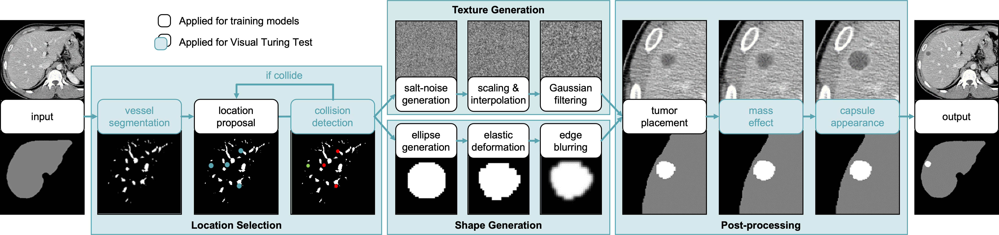

# Synthetic Liver Tumor Segmentation

A lesion inserted into a CT scan comes with a known location and shape. That gives a segmentation network both a training image and a voxel-level target. For my Neural Networks course, I implemented this approach for liver CT using MONAI and PyTorch Lightning, adapting the synthesis method of [Hu et al., *Label-Free Liver Tumor Segmentation*, CVPR 2023](https://openaccess.thecvf.com/content/CVPR2023/html/Hu_Label-Free_Liver_Tumor_Segmentation_CVPR_2023_paper.html).

## How synthetic lesions are made



*Figure from [Hu et al., *Label-Free Liver Tumor Segmentation*, CVPR 2023](https://openaccess.thecvf.com/content/CVPR2023/html/Hu_Label-Free_Liver_Tumor_Segmentation_CVPR_2023_paper.html), reproduced from the course notebook. White boxes mark the steps used for model training. Blue boxes show additional effects used for the paper’s visual Turing test.*

The generator selects locations inside the annotated liver and deforms ellipsoids to create lesions of different sizes. It smooths their edges and uses a spatially varying texture to reduce CT intensity inside each lesion. The same geometry defines the tumor mask, so every insertion produces a paired image and annotation.

<table>
  <tr>
    <th>Healthy CT with liver annotation</th>
    <th>Same CT with synthetic lesions</th>
  </tr>
  <tr>
    <td></td>
    <td></td>
  </tr>
</table>

*LiTS case 32 from the course notebook. Green marks the liver annotation. On the right, red marks the lesions added by the course generator.*

## Learning to segment a CT volume

The 3D U-Net reads a 96 × 96 × 96 voxel patch and assigns each voxel to background, liver or tumor. Its encoder collects context across the patch. Skip connections carry fine spatial detail back to the decoder as it reconstructs the segmentation. The training objective combines Dice loss, which measures overlap, with cross-entropy, which rewards assigning the correct class to each voxel.

During inference, overlapping windows cover the full scan. Gaussian blending gives more weight to predictions near the center of each window. The pipeline maps the combined scores back to the original CT grid before selecting a class for each voxel.

Dice measures how much the predicted and annotated volumes overlap. Normalized surface Dice measures how much of their surface area falls within 2 mm of the other boundary. Both are recorded separately for liver and tumor.

## Running the project

Open [the experiment notebook](SynTumor.ipynb) to configure the data split, train the network and evaluate a checkpoint. The reference training manifest selects 116 scans across four datasets. The LiTS-only configuration selects 11 healthy LiTS scans for synthesis. Both use 22 LiTS cases for validation. The optional holdout uses the other 98 LiTS cases. [Dataset preparation](docs/DATA.md)

```bash
python3 -m venv .venv
source .venv/bin/activate
python -m pip install -r requirements.txt
python -m pytest -q
```

The tests use artificial volumes to check lesion generation, spatial alignment, checkpoint recovery and export to NIfTI. The training workflow is implemented in [data.py](syntumor/data.py) and [model.py](syntumor/model.py).

**Course project by Lorenzo Soannini.** [Original synthesis implementation](https://github.com/MrGiovanni/SyntheticTumors) · [Third-party notices](THIRD_PARTY_NOTICES.md)
